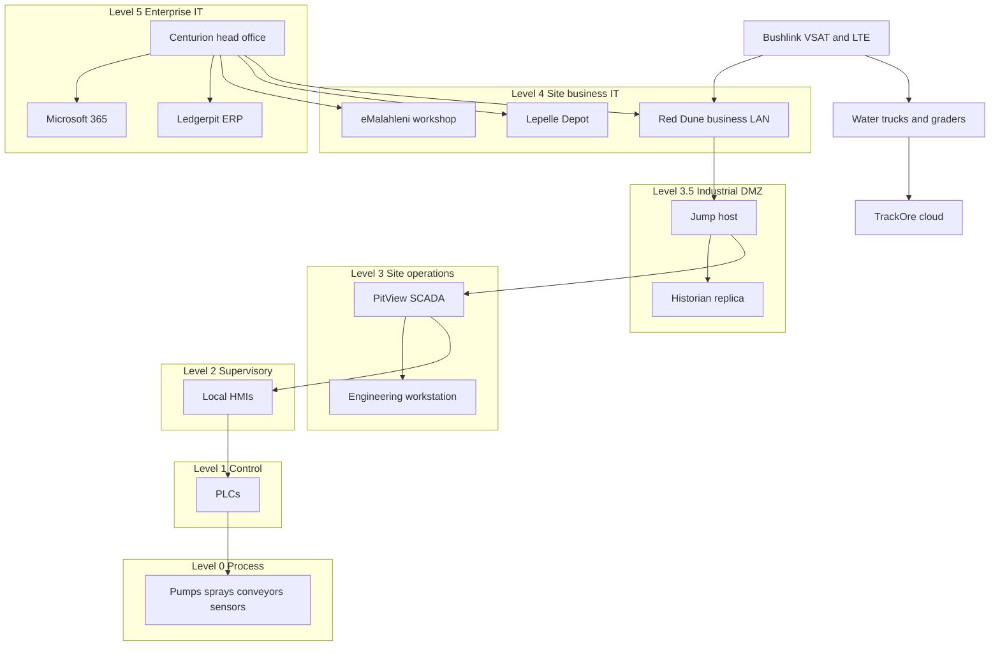

# Amberkloof Mining Systems (Pty) Ltd

**Fictional company.** Amberkloof does not exist. The sites, people, vendors, and systems below were invented for a portfolio gap assessment. They are not drawn from a real employer, a real mine, or a real supplier. Do not replace them with real names. If you need an extra system, add it here and mark it as your addition.

People named in this profile are invented characters.

## Company at a glance

| Item | Fictional detail |
| --- | --- |
| Legal name | Amberkloof Mining Systems (Pty) Ltd |
| Short name | Amberkloof |
| Type | Private company, South Africa |
| What it does | Builds surface mining equipment, and operates pit water and dust suppression under contract |
| Size | Mid sized. About 420 permanent employees, plus about 60 contractors on the operations contract |
| Head office | Centurion, Gauteng |
| Other sites | Fabrication workshop in eMalahleni, Mpumalanga. Contract site called Red Dune Pit in the Northern Cape. Spares depot called Lepelle Depot in Limpopo |
| IT owner | One IT administrator in Centurion, with after hours cover from a managed service provider |
| OT owner | The operations superintendent at Red Dune, with a control room artisan |
| Clients | Several fictional surface mines buy equipment. Only Red Dune Iron is an operations contract |

Amberkloof is a mining equipment and operations company. It is not an underground equipment maker, and it does not run its own mine. At Red Dune it is a contractor on a client site. The client, Red Dune Iron, is also fictional.

## What the company does

The fabrication workshop builds conveyor modules, transfer chutes, dust suppression skids, and pump sets for surface mines. Design drawings and bills of materials sit in the head office file share and in the Ledgerpit enterprise resource planning (ERP) system.

The operations contract is separate. At Red Dune Pit, Amberkloof runs the pit water circuit and the dust suppression sprays, and it maintains a small fleet of water trucks and graders. Those vehicles are Amberkloof assets. The pit, the main plant, and the client network belong to Red Dune Iron. Stay inside Amberkloof scope unless a shared path is needed to explain a risk.

## Sites

### Centurion head office (Level 5, enterprise IT)

A rented floor in a fictional office park. Finance, human resources, sales, design engineering, and the IT administrator work here. About 90 people. Corporate laptops, Microsoft 365, Ledgerpit, and the Active Directory domain are managed from this site. There is no plant control system here.

### eMalahleni fabrication workshop (Level 4, site business)

About 160 people on day shift. They cut, weld, and assemble equipment. The local network is a business LAN: email, a shared drive for job packs, a PC that talks to the cutter, and CCTV recorded on a local recorder. A PLC test bench in the electrical bay is used to power up panels before they are shipped. It is not connected to a production process. Treat it as a workshop asset and ask whether it is on the business LAN.

### Red Dune Pit, Northern Cape (IT and OT)

About 140 Amberkloof people on rotation, plus contractors. The site is remote. Bushlink Communications, a fictional provider, supplies VSAT as the main link and LTE as the backup. Amberkloof has a small office LAN for email, spares, and time sheets. That is the Level 4 business zone.

The OT environment is the water and dust plant Amberkloof operates:

- PitView, a fictional SCADA package, with an HMI in the control room and a historian
- PLCs on the pump sets, the dosing skid, and the spray stations
- Local HMIs at two pump houses
- An engineering workstation used to open PLC projects
- A jump host and a historian replica that the IT sketch places in an industrial demilitarised zone (often called an IDMZ, Level 3.5)

The client pit has its own plant and its own network. Amberkloof does not administer that network. Ask whether any cable, radio, or vendor session joins the two.

### Lepelle Depot, Limpopo (Level 4, site business)

About 40 people. A spares store, a light workshop, and a radio bench for vehicle kits. Business LAN only in the sketch: email, a stores PC, and a shared folder. No SCADA. Bushlink provides LTE. Staff sometimes work alone after hours.

## People and roles

Use these roles in interviews. Invent answers yourself. Do not publish the sample answers from the example rows in the workbooks.

| Role | Base | Accountable for |
| --- | --- | --- |
| Managing Director | Centurion | The company, and any risk the board would need to hear |
| Finance Manager | Centurion | Ledgerpit, payments, and the payroll bureau |
| HR Manager | Centurion | Joiners, leavers, training records, employee files |
| IT Administrator | Centurion | Identity, endpoints, backups, firewalls, and the MSP relationship |
| Design Engineering Lead | Centurion | Drawings and the product data on the file share |
| Workshop Manager | eMalahleni | The workshop, CCTV, and the panel test bench |
| Operations Superintendent | Red Dune | The water and dust contract, including OT uptime and contractors on site |
| Control room artisan | Red Dune | Day to day use of PitView and PLC changes |
| Depot Supervisor | Lepelle | Stores, the local PCs, and after hours access |
| DeskOrchard service lead | Vendor | Whatever the managed service contract actually includes |

There is no named security manager, no named privacy officer, and no in house security operations centre in this profile. Whether those roles are missing, combined with another job, or covered by a vendor is a question for your interviews. Do not score that here.

## IT environment

These are the systems the company says it has. The list is an asset picture, not a statement that the controls work.

| System | Where it runs | What it is for |
| --- | --- | --- |
| Microsoft 365 | Vendor cloud | Email, Teams, and SharePoint |
| Active Directory | Centurion | User accounts for the Amberkloof domain |
| Ledgerpit | Centurion server room | ERP: stock, jobs, purchasing, and debtors. Fictional product |
| File share | Centurion | Drawings, job packs, exported PLC projects |
| Shieldline | Agent on corporate laptops | Endpoint protection. Fictional product. Not described as installed on PLCs |
| Highveld Cloud Backup | Vendor cloud, South Africa | Backup target for the file share and Ledgerpit |
| PayMica | Vendor | Payroll bureau. Fictional |
| Workshop cutter PC and CCTV recorder | eMalahleni | Production support and cameras |
| Stores PC | Lepelle | Spares issue |
| DeskOrchard | Vendor | After hours IT helpdesk and some remote administration. Fictional MSP |

Ask where the Microsoft 365 tenant is hosted. The profile does not say. That answer matters for cross border transfer of personal information.

## OT environment

Red Dune is the only production OT site.

| Asset | Purdue level in this sketch | Notes for scope |
| --- | --- | --- |
| PitView server and historian | Level 3 | Fictional SCADA. Alarms, trends, set points |
| Engineering workstation | Level 3 | Holds copies of PLC projects |
| Jump host and historian replica | Level 3.5 | Drawn as the only path from the business LAN into OT |
| Local HMIs | Level 2 | Pump houses |
| PLCs | Level 1 | Pumps, dosing, sprays. Not domain joined |
| Pumps, sprays, instruments, conveyors on the skid | Level 0 | The process Amberkloof operates |
| Water trucks and graders | Separate from the PLC network | GPS and engine data go to TrackOre over LTE |
| Panel test bench | Workshop, not this plant | Ask which network it sits on |

TrackOre is a fictional fleet telematics platform. It receives location, engine hours, and a driver identifier from the vehicles. It is a vendor cloud, not part of PitView.

A PLC failure or a bad set point can stop dust suppression or overflow a settling dam. Treat that as a safety and environmental consequence as well as a cyber consequence. The client holds the mining right. Amberkloof holds the contract to run this circuit. Your report should say who phones whom if the plant is unsafe to run. This profile does not decide that.

## Third party vendors

| Vendor | Fictional service | Data or access they may have |
| --- | --- | --- |
| DeskOrchard Managed Services | Helpdesk and some admin work | Corporate accounts, possibly firewalls. Confirm the contract |
| Highveld Cloud Backup | Off site backup | Copies of files and ERP data |
| PayMica | Payroll | Employee bank details and tax numbers |
| Bushlink Communications | VSAT and LTE | The paths into Red Dune and Lepelle |
| TrackOre (Pty) Ltd | Fleet telematics | Vehicle location and driver identity |
| Stonehealth Mobile Clinics | Occupational health visits | Health information. This is special personal information under POPIA |
| Mothlight Components | Bought in idlers and drives | A supplier. Ask if they ever connect to Amberkloof systems |
| Microsoft | Microsoft 365 | Email and files |
| Red Dune Iron | Client, site owner | Shared site rules, induction, and any shared network path |

Vendor names are invented. Do not swap in a real supplier.

## Network sketch

The IT administrator drew this sketch for the exercise. It shows where systems are meant to sit. It is not evidence that firewalls, accounts, or jump host rules exist or are followed. Confirm every path in interviews before you rate network segregation.

IT zones in this reading of the Purdue model are Level 5 and Level 4. Level 3.5 is the boundary. Level 3 down to Level 0 are OT zones. Telematics is a separate vendor path.

Purdue levels, in plain language:

| Level | Name in this profile | Amberkloof examples |
| --- | --- | --- |
| 5 | Enterprise | Centurion, Microsoft 365, Ledgerpit, Active Directory |
| 4 | Site business | Workshop, depot, Red Dune office LAN |
| 3.5 | Industrial DMZ | Jump host, historian replica |
| 3 | Site operations | PitView server, historian, engineering workstation |
| 2 | Supervisory | Local HMIs |
| 1 | Basic control | PLCs |
| 0 | Process | Pumps, sprays, instruments, skid conveyors |

Some drawings put the SCADA server at Level 2. This profile puts the PitView server at Level 3 and the local HMIs at Level 2. Say which reading you use when you write the report.

## Personal information in scope

List these as information assets. You decide the control ratings.

- Employee files: identity numbers, addresses, bank details, next of kin
- Payroll file at PayMica
- Occupational health records from Stonehealth
- CCTV at the workshop
- TrackOre driver identity and vehicle location
- Email, which will contain a mix of business and personal data
- Visitor and induction records at Red Dune, which may be held by the client. Ask.

This list is not a POPIA finding. The legal context sits in the report template. Your job is to decide whether the safeguards match the information.

## Suggested scope

In scope: Amberkloof information and systems at all four sites, the vendors above, and the OT plant Amberkloof operates at Red Dune.

Out of scope unless an interview forces a shared risk into view: Red Dune Iron's own mine plant, the client's enterprise network, and any mine that only buys a conveyor module and runs it itself.

## What this profile does not give you

It does not give current state, target state, gap ratings, tiers, likelihood, impact, risk scores, treatments, or priorities. Those cells are yours. A blank cell means you have not finished, not that the control is fine.
